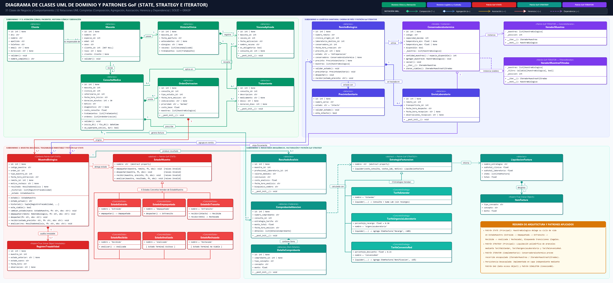
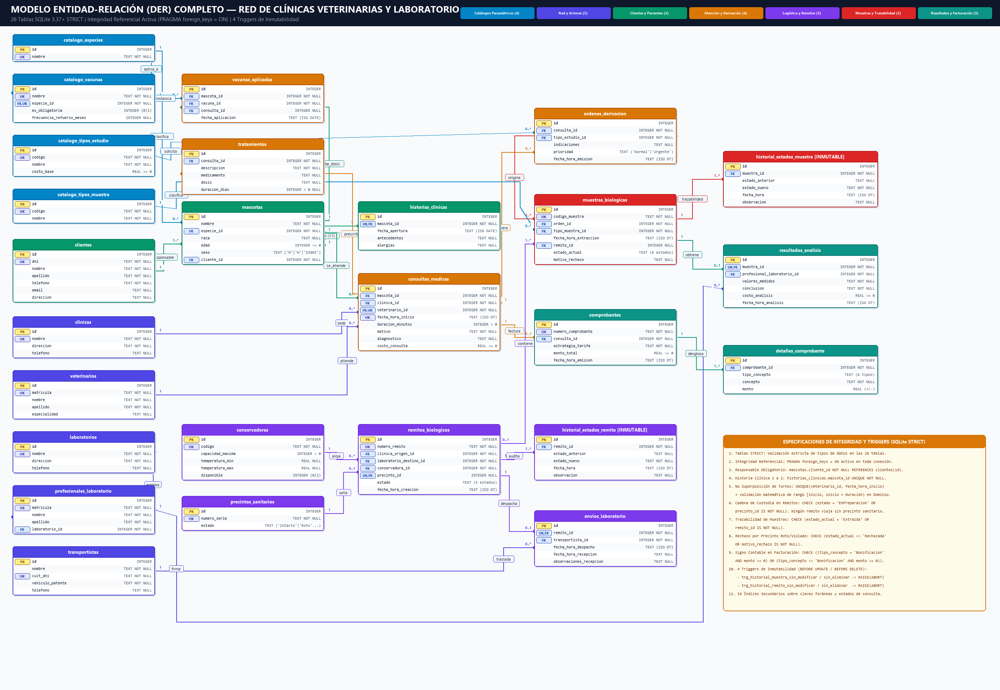

# 🐾 Sistema de Gestión Veterinaria y Derivación de Laboratorio

[](https://www.python.org/downloads/)
[](https://www.sqlite.org/)
[](tests/)
[](src/patrones/)

Sistema integral orientado a objetos con persistencia relacional para la administración de una red de clínicas veterinarias, atención clínica de pacientes y gestión logística con cadena de frío, custodia sanitaria y trazabilidad inmutable para la derivación de muestras biológicas hacia un laboratorio central de análisis.

> **Proyecto Integrador de Cátedra:** Desarrollo de Aplicaciones con Objetos (DAO) — Ingeniería en Sistemas de Información (UTN FRC — Ciclo Lectivo 2026).  
> **Tema:** Tema 2 — Veterinaria: Red de Clínicas y Derivación de Laboratorio.

---

## 📌 Objetivos y Alcance Funcional

El sistema modela la operativa diaria de una red veterinaria y resuelve integralmente los **7 procesos obligatorios** del dominio junto con sus **5 reglas críticas de negocio**:

1. **Gestión Clínica, Pacientes e Historia Clínica Única (Procesos 1, 2 y 3):**
   - Administración (ABMC y búsquedas multicriterio) de **Clientes** responsables y **Mascotas** tipificadas por catálogo de especies (*Canino, Felino, Ave, Roedor, Reptil*).
   - **Regla de Negocio — Responsable Obligatorio:** Ninguna mascota puede registrarse sin un cliente responsable asociado (`ErrorMascotaSinResponsable` + `FOREIGN KEY NOT NULL`).
   - **Historia Clínica Digital (`1 a 1`):** Apertura atómica junto con el alta de la mascota, registrando antecedentes, alergias, tratamientos farmacológicos y control automático de **vacunas obligatorias** pendientes o vencidas por especie.
   - **Regla de Negocio — No Superposición de Turnos:** Control matemático de intervalos horarios `[inicio, inicio + duración)` por veterinario (`ErrorSuperposicionTurno`) y restricción `UNIQUE(veterinario_id, fecha_hora_inicio)`.

2. **Logística Sanitaria, Cadena de Frío y Trazabilidad Inmutable (Procesos 4, 5 y 6):**
   - Emisión de **Órdenes de Derivación** (`Normal` / `Urgente`) y extracción de **Muestras Biológicas** identificadas unívocamente.
   - Empaquetado en **Conservadoras Isotérmicas** validando su capacidad física máxima (`ErrorCapacidadConservadoraExcedida`), emisión de **Remitos Biológicos** y sellado con **Precintos Sanitarios** numerados (`Intacto` | `Roto` | `Violado`).
   - **Regla de Negocio — Trazabilidad Inmutable:** Ciclo de vida controlado mediante el patrón **State** (`Extraida` → `Empaquetada` → `EnTransito` → `Recibida` → `Analizada` / `Rechazada`). Cada cambio de estado queda asentado en objetos de valor inmutables (`@dataclass(frozen=True)`) y tablas de auditoría protegidas por **4 Triggers SQLite** (`BEFORE UPDATE` / `BEFORE DELETE` con `RAISE(ABORT)`).
   - **Regla de Negocio — Bloqueo por Precinto Vulnerado:** Si en la recepción del laboratorio el precinto sanitario arriba `Roto` o `Violado`, el remito y todas sus muestras pasan automáticamente a estado terminal `Rechazado`/`Rechazada` documentando el motivo e impidiendo su análisis bioquímico.

3. **Resultados Bioquímicos y Facturación Polimórfica (Proceso 7):**
   - Carga de **Resultados de Análisis** firmados por bioquímicos matriculados (habilitada únicamente para muestras en estado `Recibida`).
   - Emisión de **Comprobantes de Atención** (`cabecera` y `detalles`) aplicando dinámicamente estrategias arancelarias intercambiables (**Patrón Strategy**: `TarifaEstandar`, `TarifaUrgenciaLaboratorio` `+30%`, `TarifaConvenioRed` `-15%`).

---

## 🏗️ Estructura del Proyecto y Arquitectura en Capas

```text
proyecto_veterinaria/
├── .gitignore
├── README.md
├── requirements.txt                                  # customtkinter>=5.2, pypdf
├── veterinaria.db                                    # Base de datos SQLite 3.37+ STRICT generada localmente
├── docs/                                             # Documentación académica, entregables y diagramas HD
│   ├── Presentacion-grupo.docx                       # Primer Entregable oficial UTN-FRC completado
│   ├── Presentacion-grupo-plantilla-original.docx    # Copia de respaldo de la plantilla original en blanco
│   ├── diagrama_DER_completo.png                     # Diagrama Entidad-Relación completo (26 tablas STRICT)
│   ├── diagrama_clases_UML_completo.png              # Diagrama de Clases UML de Dominio y Patrones GoF (31 clases)
│   ├── diagrama_BD.svg                               # Exportación vectorial SVG de apoyo
│   ├── especificacion_base_datos_y_arquitectura.md   # Especificación técnica exhaustiva de la BD y DDL
│   ├── diagrama_de_clases_y_diseno_poo.md            # Fundamentación OO, principios SOLID/GRASP y patrones GoF
│   ├── TRABAJOPRACTICO.pdf                           # Enunciado oficial de la cátedra DAO (2026)
│   └── DB Guia Objetos de Acceso.docx                # Guía teórica de la cátedra sobre el patrón DAO
├── src/
│   ├── __init__.py
│   ├── dominio/                                      # [100% COMPLETO] Entidades ricas y reglas de validación
│   │   ├── cliente.py                                # Entidad Cliente
│   │   ├── mascota.py                                # Entidad Mascota (responsable obligatorio)
│   │   ├── historia_clinica.py                       # HistoriaClinica, VacunaAplicada y Tratamiento
│   │   ├── consulta_medica.py                        # ConsultaMedica (control horario) y OrdenDerivacion
│   │   ├── muestra_biologica.py                      # MuestraBiologica (Contexto State) y RegistroTrazabilidad
│   │   ├── logistica.py                              # ConservadoraIsotermica, PrecintoSanitario, RemitoBiologico, EnvioLaboratorio
│   │   ├── facturacion.py                            # ResultadoAnalisis, ComprobanteAtencion y DetalleComprobante
│   │   └── excepciones.py                            # Jerarquía de 12 excepciones semánticas (ErrorVeterinaria)
│   ├── patrones/                                     # [100% COMPLETO] Patrones de Diseño GoF
│   │   ├── estado_muestra.py                         # Patrón STATE (EstadoMuestra + 6 estados concretos)
│   │   ├── estrategia_facturacion.py                 # Patrón STRATEGY (EstrategiaFacturacion + 3 tarifas)
│   │   └── iterador_muestras.py                      # Patrón ITERATOR (IteradorMuestras + IteradorMuestrasFiltradas)
│   ├── persistencia/                                 # [100% COMPLETO] Capa DAO + Singleton + SQLite STRICT
│   │   ├── esquema.sql                               # DDL de 26 tablas STRICT, constraints nombrados, 14 índices y 4 triggers
│   │   ├── conexion_bd.py                            # Patrón SINGLETON (ConexionBD) y unidad de trabajo atómica
│   │   ├── inicializador_bd.py                       # Creador idempotente del esquema y semillas paramétricas
│   │   ├── traductor_errores.py                      # Traductor de sqlite3.Error a excepciones del dominio
│   │   ├── dao_base.py                               # Clase abstracta DAOBase
│   │   ├── cliente_dao.py                            # ClienteDAO
│   │   ├── mascota_dao.py                            # MascotaDAO
│   │   ├── consulta_dao.py                           # ConsultaDAO
│   │   ├── muestra_dao.py                            # MuestraDAO
│   │   ├── logistica_dao.py                          # LogisticaDAO
│   │   └── facturacion_dao.py                        # FacturacionDAO
│   ├── servicios/                                    # [EN DESARROLLO] Orquestación de casos de uso y reportes PDF
│   └── interfaz/                                     # [EN DESARROLLO] Interfaz gráfica de escritorio (CustomTkinter)
└── tests/                                            # [100% COMPLETO] 57 tests automatizados pasando en ~0.40s
    ├── test_persistencia_base.py                     # Tests de Singleton, integridad referencial, CHECKs y Triggers
    ├── test_dominio_y_patrones.py                    # Tests unitarios de entidades y de los patrones GoF
    └── test_daos.py                                  # Tests de integración de los 6 DAOs contra SQLite en memoria
```

---

## 📊 Diagramas de Arquitectura y Base de Datos

### 1. Diagrama de Clases UML — Dominio y Patrones GoF (31 Clases y 32 Relaciones)
Modela las **31 clases de Dominio y Patrones GoF** (**State**, **Strategy** e **Iterator**) con sus **32 relaciones UML** de Composición (`*--`), Agregación (`o--`), Asociación (`-->`), Herencia (`<|--`) y Dependencia (`..>`), manteniendo la capa de persistencia (**Singleton** + **DAO**) y las excepciones desacopladas en sus módulos respectivos para maximizar la legibilidad del modelo de negocio.



> 📄 **Documentación detallada del diseño OO:** Ver [`docs/diagrama_de_clases_y_diseno_poo.md`](docs/diagrama_de_clases_y_diseno_poo.md).

---

### 2. Modelo Entidad-Relación (DER) Completo (26 Tablas `STRICT`)
Modela las **26 tablas relacionales** en SQLite 3.37+ (`STRICT`), con claves primarias (`PK`), foráneas (`FK`), restricciones de unicidad (`UK`), `CHECK` constraints nombrados, 14 índices secundarios y 4 triggers de inmutabilidad.



> 📄 **Especificación técnica de la Base de Datos:** Ver [`docs/especificacion_base_datos_y_arquitectura.md`](docs/especificacion_base_datos_y_arquitectura.md).

---

## 🧩 Resumen de Patrones de Diseño Implementados

| Patrón | Rol | Ubicación | Propósito en el Sistema |
| :--- | :--- | :--- | :--- |
| **State** *(GoF)* | **Principal** | [`src/patrones/estado_muestra.py`](src/patrones/estado_muestra.py) | Gobernador del ciclo de vida de `MuestraBiologica` (`Extraida` → `Empaquetada` → `EnTransito` → `Recibida` → `Analizada` / `Rechazada`). Elimina condicionales complejos y bloquea transiciones ilegales lanzando `ErrorTransicionEstadoInvalida`. |
| **Strategy** *(GoF)* | **Principal** | [`src/patrones/estrategia_facturacion.py`](src/patrones/estrategia_facturacion.py) | Cálculo polimórfico e intercambiable de liquidaciones arancelarias (`TarifaEstandar`, `TarifaUrgenciaLaboratorio` con `+30%` sobre estudios y `TarifaConvenioRed` con `-15%` sobre clínica). |
| **Singleton** *(GoF)* | **Principal** | [`src/persistencia/conexion_bd.py`](src/persistencia/conexion_bd.py) | Garantiza una única instancia activa de `ConexionBD`, forzando `PRAGMA foreign_keys = ON` y administrando transacciones atómicas anidadas (`with bd.transaccion():`). |
| **DAO** *(Persistencia)* | **Principal** | [`src/persistencia/*_dao.py`](src/persistencia/) | Desacopla por completo las entidades del dominio de las consultas SQL parametrizadas y traduce errores nativos de SQLite a excepciones semánticas mediante `ejecutar_seguro`. |
| **Iterator** *(GoF)* | **Complementario** | [`src/patrones/iterador_muestras.py`](src/patrones/iterador_muestras.py) | Recorrido secuencial desacoplado de las muestras alojadas en `ConservadoraIsotermica`, proveyendo tanto un iterador completo (`IteradorMuestras`) como un iterador filtrado (`IteradorMuestrasFiltradas` para muestras viables). |

---

## 🚀 Guía de Inicio Rápido

### 1. Requisitos Previos
* **Python 3.11 o superior** (incluye soporte nativo para `sqlite3` con tablas `STRICT`).
* **Git**.

### 2. Clonar el repositorio y crear el entorno virtual

* **En Windows (PowerShell):**
  ```powershell
  git clone https://github.com/tu-usuario/proyecto_veterinaria.git
  cd proyecto_veterinaria
  python -m venv .venv
  .\.venv\Scripts\Activate.ps1
  ```
* **En Linux / macOS:**
  ```bash
  git clone https://github.com/tu-usuario/proyecto_veterinaria.git
  cd proyecto_veterinaria
  python3 -m venv .venv
  source .venv/bin/activate
  ```

### 3. Instalar dependencias
```bash
pip install -r requirements.txt
pip install pytest
```

### 4. Inicializar la Base de Datos Local (`veterinaria.db`)
Ejecuta el inicializador idempotente para crear las 26 tablas `STRICT`, los 4 triggers de inmutabilidad y precargar los catálogos paramétricos (especies, vacunas, estudios bioquímicos, tipos de muestra, clínicas, laboratorios, transportistas y conservadoras):

```bash
python -m src.persistencia.inicializador_bd
```

### 5. Ejecutar la Suite de Pruebas Automatizadas
Para verificar las entidades de dominio, los patrones GoF, las restricciones SQLite, los triggers de inmutabilidad y los 6 DAOs:

```bash
python -m pytest -v
```

### 6. Ejemplo de Uso Programático (Dominio + DAOs)

```python
from src.dominio.cliente import Cliente
from src.dominio.mascota import Mascota
from src.persistencia.cliente_dao import ClienteDAO
from src.persistencia.mascota_dao import MascotaDAO
from src.persistencia.inicializador_bd import inicializar_base_datos

# 1. Asegurar esquema y catálogos cargados
inicializar_base_datos()

cliente_dao = ClienteDAO()
mascota_dao = MascotaDAO()

# 2. Registrar un cliente responsable
nuevo_cliente = Cliente(
    id=None,
    dni="40123456",
    nombre="Juan",
    apellido="Pérez",
    telefono="3514455667",
    email="juan.perez@example.com",
    direccion="Av. Vélez Sarsfield 1200",
)
cliente_id = cliente_dao.crear(nuevo_cliente)
cliente_recuperado = cliente_dao.obtener_por_id(cliente_id)
print(f"Cliente registrado: {cliente_recuperado.nombre_completo()} (ID: {cliente_id})")

# 3. Registrar una mascota (abre automáticamente su Historia Clínica 1 a 1 en la misma transacción)
nueva_mascota = Mascota(
    id=None,
    nombre="Toby",
    especie_id=1,  # 1 = Canino
    edad=3,
    sexo="M",
    cliente_id=cliente_id,
    raza="Labrador",
)
mascota_id = mascota_dao.crear(nueva_mascota, antecedentes="Sin cirugías previas", alergias="Ninguna")
historia = mascota_dao.obtener_historia_clinica(mascota_id)
print(f"Mascota registrada con ID {mascota_id} -> Historia Clínica #{historia.id} abierta el {historia.fecha_apertura}")
```

---

## 📚 Documentación y Entregables en [`docs/`](docs/)

* 📄 **[`docs/Presentacion-grupo.docx`](docs/Presentacion-grupo.docx):** Primer Entregable oficial de la cátedra completado (Objetivos, Alcances, DER completo y Diagrama de Clases UML completo incrustados).
* 📘 **[`docs/especificacion_base_datos_y_arquitectura.md`](docs/especificacion_base_datos_y_arquitectura.md):** Documentación técnica de las 26 tablas `STRICT`, claves, restricciones `CHECK`, índices y triggers.
* 📙 **[`docs/diagrama_de_clases_y_diseno_poo.md`](docs/diagrama_de_clases_y_diseno_poo.md):** Fundamentación de todas las clases, responsabilidades, relaciones UML, principios SOLID/GRASP y patrones GoF.
* 🖼️ **[`docs/diagrama_DER_completo.png`](docs/diagrama_DER_completo.png):** Imagen en alta resolución del Diagrama Entidad-Relación completo.
* 🖼️ **[`docs/diagrama_clases_UML_completo.png`](docs/diagrama_clases_UML_completo.png):** Imagen en alta resolución del Diagrama de Clases UML completo.
