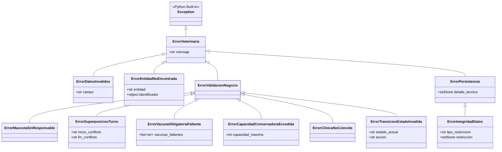

# Diagrama de Clases UML y Fundamentación de Diseño Orientado a Objetos
## Proyecto Integrador: Red de Clínicas Veterinarias y Derivación de Laboratorio
**Cátedra:** Desarrollo de Aplicaciones con Objetos (DAO) — Ingeniería en Sistemas de Información (2026)  
**Tema:** Tema 2 — Veterinaria: Red de Clínicas y Derivación de Laboratorio  

---

## 1. Diagrama de Clases UML — Capa de Dominio y Patrones GoF

El siguiente diagrama modela todas las clases del dominio y los patrones de comportamiento (**State**, **Strategy**, **Iterator**), respetando la notación estándar UML de visibilidad (`+` público, `-` privado, `#` protegido) y tipos de relaciones (`*--` composición, `o--` agregación, `-->` asociación, `<|--` herencia/generalización, `..>` dependencia).

```mermaid
classDiagram
    direction TB

    %% =====================================================================
    %% SUBDOMINIO 1: CLIENTES, MASCOTAS E HISTORIA CLÍNICA
    %% =====================================================================
    class Cliente {
        +int|None id
        +str dni
        +str nombre
        +str apellido
        +str telefono
        +str|None email
        +str|None direccion
        +validar() void
        +nombre_completo() str
    }

    class Mascota {
        +int|None id
        +str nombre
        +int especie_id
        +int edad
        +str sexo
        +int cliente_id
        +str|None raza
        +str|None nombre_especie
        +Cliente|None cliente
        +validar() void
    }

    class HistoriaClinica {
        +int|None id
        +int mascota_id
        +str fecha_apertura
        +str|None antecedentes
        +str|None alergias
        +list~VacunaAplicada~ vacunas
        +list~Tratamiento~ tratamientos
    }

    class VacunaAplicada {
        +int|None id
        +int mascota_id
        +int vacuna_id
        +str fecha_aplicacion
        +str nombre_vacuna
        +bool es_obligatoria
        +int|None consulta_id
    }

    class Tratamiento {
        +int|None id
        +int consulta_id
        +str descripcion
        +str|None medicamento
        +str|None dosis
        +int|None duracion_dias
    }

    Cliente "1" o-- "1..*" Mascota : es responsable de >
    Mascota "1" *-- "1" HistoriaClinica : posee >
    HistoriaClinica "1" *-- "0..*" VacunaAplicada : registra >
    HistoriaClinica "1" o-- "0..*" Tratamiento : recopila >

    %% =====================================================================
    %% SUBDOMINIO 2: ATENCIÓN MÉDICA Y DERIVACIÓN
    %% =====================================================================
    class ConsultaMedica {
        +int|None id
        +int mascota_id
        +int clinica_id
        +int veterinario_id
        +str fecha_hora_inicio
        +int duracion_minutos
        +str motivo
        +str|None diagnostico
        +float costo_consulta
        +list~Tratamiento~ tratamientos
        +list~OrdenDerivacion~ ordenes
        +validar() void
        +inicio_dt() datetime
        +fin_dt() datetime
        +fecha_hora_fin() str
        +se_superpone_con(inicio_iso: str, duracion_min: int) bool
    }

    class OrdenDerivacion {
        +int|None id
        +int consulta_id
        +int tipo_estudio_id
        +str fecha_hora_emision
        +str|None indicaciones
        +str prioridad
        +str nombre_estudio
        +float costo_base
        +list~MuestraBiologica~ muestras
    }

    Mascota "1" --> "0..*" ConsultaMedica : recibe >
    ConsultaMedica "1" *-- "0..*" Tratamiento : prescribe >
    ConsultaMedica "1" *-- "0..*" OrdenDerivacion : emite >
    ConsultaMedica "0..1" --> "0..*" VacunaAplicada : aplica en >

    %% =====================================================================
    %% SUBDOMINIO 3: MUESTRA BIOLÓGICA Y PATRÓN STATE
    %% =====================================================================
    class MuestraBiologica {
        +int|None id
        +str codigo_muestra
        +int orden_id
        +int tipo_muestra_id
        +str fecha_hora_extraccion
        +int|None remito_id
        +str|None motivo_rechazo
        +str nombre_tipo_muestra
        +ResultadoAnalisis|None resultado
        -list~RegistroTrazabilidad~ _historial
        -EstadoMuestra _estado
        +estado() EstadoMuestra
        +estado_actual() str
        +historial() tuple~RegistroTrazabilidad~
        +esta_viable() bool
        +cambiar_estado(nuevo_estado: EstadoMuestra, fecha_hora: str, observacion: str) void
        +empaquetar(remito: RemitoBiologico, fecha_hora: str, observacion: str) void
        +despachar(fecha_hora: str, observacion: str) void
        +recibir(estado_precinto: str, fecha_hora: str, observacion: str) void
        +analizar(resultado: ResultadoAnalisis, fecha_hora: str, observacion: str) void
    }

    class RegistroTrazabilidad {
        <<frozen>>
        +int|None id
        +int muestra_id
        +str|None estado_anterior
        +str estado_nuevo
        +str fecha_hora
        +str|None observacion
    }

    class EstadoMuestra {
        <<abstract>>
        +nombre()* str
        +empaquetar(muestra: MuestraBiologica, remito: RemitoBiologico, fecha_hora: str, obs: str) void
        +despachar(muestra: MuestraBiologica, fecha_hora: str, obs: str) void
        +recibir(muestra: MuestraBiologica, estado_precinto: str, fecha_hora: str, obs: str) void
        +analizar(muestra: MuestraBiologica, resultado: ResultadoAnalisis, fecha_hora: str, obs: str) void
    }

    class EstadoExtraida {
        +nombre() str
        +empaquetar(muestra: MuestraBiologica, remito: RemitoBiologico, fecha_hora: str, obs: str) void
    }

    class EstadoEmpaquetada {
        +nombre() str
        +despachar(muestra: MuestraBiologica, fecha_hora: str, obs: str) void
    }

    class EstadoEnTransito {
        +nombre() str
        +recibir(muestra: MuestraBiologica, estado_precinto: str, fecha_hora: str, obs: str) void
    }

    class EstadoRecibida {
        +nombre() str
        +analizar(muestra: MuestraBiologica, resultado: ResultadoAnalisis, fecha_hora: str, obs: str) void
    }

    class EstadoAnalizada {
        +nombre() str
    }

    class EstadoRechazada {
        +nombre() str
    }

    OrdenDerivacion "1" *-- "1..*" MuestraBiologica : origina >
    MuestraBiologica "1" *-- "1..*" RegistroTrazabilidad : audita en >
    MuestraBiologica "1" --> "1" EstadoMuestra : delega estado >
    EstadoMuestra <|-- EstadoExtraida
    EstadoMuestra <|-- EstadoEmpaquetada
    EstadoMuestra <|-- EstadoEnTransito
    EstadoMuestra <|-- EstadoRecibida
    EstadoMuestra <|-- EstadoAnalizada
    EstadoMuestra <|-- EstadoRechazada

    %% =====================================================================
    %% SUBDOMINIO 4: LOGÍSTICA E ITERATOR
    %% =====================================================================
    class ConservadoraIsotermica {
        +int|None id
        +str codigo
        +int capacidad_maxima
        +float|None temperatura_min
        +float|None temperatura_max
        +bool disponible
        -list~MuestraBiologica~ _muestras
        +cantidad_muestras() int
        +espacio_disponible() int
        +agregar_muestra(muestra: MuestraBiologica) void
        +vaciar() void
        +__iter__() IteradorMuestras
        +iterar_viables() IteradorMuestrasFiltradas
    }

    class IteradorMuestras {
        <<Iterator>>
        -list~MuestraBiologica~ _muestras
        -int _posicion
        +__iter__() IteradorMuestras
        +__next__() MuestraBiologica
    }

    class IteradorMuestrasFiltradas {
        <<Iterator>>
        -list~MuestraBiologica~ _muestras
        -Callable _filtro
        -int _posicion
        +__iter__() IteradorMuestrasFiltradas
        +__next__() MuestraBiologica
    }

    class PrecintoSanitario {
        +int|None id
        +str numero_serie
        +str estado
        +validar_estado() void
        +esta_intacto() bool
    }

    class RemitoBiologico {
        +int|None id
        +str numero_remito
        +int clinica_origen_id
        +int laboratorio_destino_id
        +int conservadora_id
        +str fecha_hora_creacion
        +int|None precinto_id
        +str estado
        +ConservadoraIsotermica|None conservadora
        +PrecintoSanitario|None precinto
        +list~MuestraBiologica~ muestras
        +validar_estado() void
        +precintar(precinto: PrecintoSanitario) void
        +despachar() void
        +recibir(estado_precinto: str) void
    }

    class EnvioLaboratorio {
        +int|None id
        +int remito_id
        +int transportista_id
        +str fecha_hora_despacho
        +str|None fecha_hora_recepcion
        +str|None observaciones_recepcion
    }

    ConservadoraIsotermica "1" o-- "0..*" MuestraBiologica : aloja >
    ConservadoraIsotermica ..> IteradorMuestras : instancia >
    ConservadoraIsotermica ..> IteradorMuestrasFiltradas : instancia >
    RemitoBiologico "1" --> "1" ConservadoraIsotermica : utiliza >
    RemitoBiologico "1" --> "0..1" PrecintoSanitario : sellado con >
    RemitoBiologico "1" o-- "1..*" MuestraBiologica : agrupa >
    RemitoBiologico "1" *-- "0..1" EnvioLaboratorio : se traslada en >

    %% =====================================================================
    %% SUBDOMINIO 5: RESULTADOS, FACTURACIÓN Y PATRÓN STRATEGY
    %% =====================================================================
    class ResultadoAnalisis {
        +int|None id
        +int muestra_id
        +int profesional_laboratorio_id
        +str valores_medidos
        +str conclusion
        +float costo_analisis
        +str fecha_hora_analisis
        +str bioquimico_nombre
    }

    class ComprobanteAtencion {
        +int|None id
        +str numero_comprobante
        +int consulta_id
        +str estrategia_tarifa
        +float monto_total
        +str fecha_hora_emision
        +list~DetalleComprobante~ detalles
    }

    class DetalleComprobante {
        +int|None id
        +int|None comprobante_id
        +str tipo_concepto
        +str concepto
        +float monto
    }

    class EstrategiaFacturacion {
        <<abstract>>
        +nombre()* str
        +liquidar(costo_consulta: float, costos_lab: list, motivo: str)* LiquidacionFactura
    }

    class TarifaEstandar {
        +nombre() str
        +liquidar(costo_consulta: float, costos_lab: list, motivo: str) LiquidacionFactura
    }

    class TarifaUrgenciaLaboratorio {
        +float porcentaje_recargo
        +nombre() str
        +liquidar(costo_consulta: float, costos_lab: list, motivo: str) LiquidacionFactura
    }

    class TarifaConvenioRed {
        +float porcentaje_descuento
        +nombre() str
        +liquidar(costo_consulta: float, costos_lab: list, motivo: str) LiquidacionFactura
    }

    class LiquidacionFactura {
        +str nombre_estrategia
        +float subtotal_clinica
        +float subtotal_laboratorio
        +list~ItemFactura~ items
        +float total
    }

    class ItemFactura {
        <<frozen>>
        +str tipo_concepto
        +str concepto
        +float monto
    }

    MuestraBiologica "1" --> "0..1" ResultadoAnalisis : produce >
    ConsultaMedica "1" --> "0..1" ComprobanteAtencion : genera >
    ComprobanteAtencion "1" *-- "1..*" DetalleComprobante : contiene >
    ComprobanteAtencion ..> EstrategiaFacturacion : calculado con >
    EstrategiaFacturacion ..> LiquidacionFactura : retorna >
    LiquidacionFactura "1" *-- "1..*" ItemFactura : desglosa >
    EstrategiaFacturacion <|-- TarifaEstandar
    EstrategiaFacturacion <|-- TarifaUrgenciaLaboratorio
    EstrategiaFacturacion <|-- TarifaConvenioRed
```

---

## 2. Diagrama de Clases UML — Capa de Persistencia (Patrón DAO y Singleton)

```mermaid
classDiagram
    direction TB

    class ConexionBD {
        <<Singleton>>
        -ConexionBD|None _instancia$
        -Connection|None _conexion
        -str _ruta_bd
        -int _profundidad_transaccion
        -bool _solo_deshacer
        +obtener_instancia(ruta_bd: str|Path|None)$ ConexionBD
        +reiniciar_instancia()$ void
        +ruta_bd() str
        +esta_abierta() bool
        +en_transaccion() bool
        +transaccion() Iterator~Cursor~
        +consultar_uno(sql: str, parametros: Sequence) Row|None
        +consultar_todos(sql: str, parametros: Sequence) list~Row~
        +ejecutar_script(script: str) void
        +cerrar() void
    }

    class DAOBase {
        <<abstract>>
        +ConexionBD conexion
        +__init__(conexion: ConexionBD|None)
        +cursor_transaccional() ContextManager
    }

    class ClienteDAO {
        +crear(cliente: Cliente) int
        +actualizar(cliente: Cliente) void
        +eliminar(cliente_id: int) void
        +obtener_por_id(cliente_id: int) Cliente|None
        +obtener_por_dni(dni: str) Cliente|None
        +listar_todos() list~Cliente~
        +buscar(termino: str) list~Cliente~
        -_mapear_fila(fila: Row)$ Cliente
    }

    class MascotaDAO {
        +crear(mascota: Mascota, fecha_apertura: str|None) int
        +actualizar(mascota: Mascota) void
        +eliminar(mascota_id: int) void
        +obtener_por_id(mascota_id: int) Mascota|None
        +listar_por_cliente(cliente_id: int) list~Mascota~
        +listar_todas() list~Mascota~
        +registrar_vacuna_aplicada(vacuna: VacunaAplicada) int
        +listar_vacunas_de_mascota(mascota_id: int) list~VacunaAplicada~
        +obtener_catalogo_vacunas_obligatorias(especie_id: int) list~dict~
        +obtener_vacunas_pendientes(mascota_id: int, fecha_ref: str|None) list~dict~
        +obtener_historia_clinica(mascota_id: int) HistoriaClinica|None
        +actualizar_historia_clinica(mascota_id: int, antecedentes: str, alergias: str) void
        -_mapear_fila(fila: Row)$ Mascota
    }

    class ConsultaDAO {
        +crear(consulta: ConsultaMedica) int
        +actualizar_diagnostico(consulta_id: int, diagnostico: str) void
        +obtener_por_id(consulta_id: int) ConsultaMedica|None
        +listar_por_veterinario_y_fecha(veterinario_id: int, fecha_str: str) list~ConsultaMedica~
        +listar_por_mascota(mascota_id: int) list~ConsultaMedica~
        +obtener_tratamientos_por_consulta(consulta_id: int) list~Tratamiento~
        +crear_orden_derivacion(orden: OrdenDerivacion) int
        +obtener_orden_por_id(orden_id: int) OrdenDerivacion|None
        +listar_ordenes_por_consulta(consulta_id: int) list~OrdenDerivacion~
        -_mapear_fila(fila: Row)$ ConsultaMedica
    }

    class MuestraDAO {
        +crear(muestra: MuestraBiologica) int
        +actualizar_estado(muestra_id: int, ant: str, nuevo: str, fecha: str, obs: str, motivo: str, remito_id: int) void
        +obtener_por_id(muestra_id: int) MuestraBiologica|None
        +obtener_por_codigo(codigo_muestra: str) MuestraBiologica|None
        +listar_por_orden(orden_id: int) list~MuestraBiologica~
        +listar_por_remito(remito_id: int) list~MuestraBiologica~
        +listar_por_estado(estado: str) list~MuestraBiologica~
        +obtener_historial(muestra_id: int) list~RegistroTrazabilidad~
        +listar_muestras_rechazadas_con_transporte() list~dict~
        -_mapear_fila(fila: Row, historial: list)$ MuestraBiologica
    }

    class LogisticaDAO {
        +listar_conservadoras_disponibles() list~ConservadoraIsotermica~
        +obtener_conservadora_por_id(conservadora_id: int) ConservadoraIsotermica|None
        +actualizar_disponibilidad_conservadora(conservadora_id: int, disp: bool) void
        +crear_precinto(numero_serie: str, estado: str) int
        +obtener_precinto_por_id(precinto_id: int) PrecintoSanitario|None
        +obtener_precinto_por_numero(numero_serie: str) PrecintoSanitario|None
        +actualizar_estado_precinto(precinto_id: int, nuevo_estado: str) void
        +crear_remito(remito: RemitoBiologico) int
        +actualizar_estado_remito(remito_id: int, ant: str, nuevo: str, fecha: str, obs: str, precinto_id: int) void
        +obtener_remito_por_id(remito_id: int) RemitoBiologico|None
        +obtener_remito_por_numero(numero_remito: str) RemitoBiologico|None
        +listar_remitos_por_estado(estado: str) list~RemitoBiologico~
        +crear_envio(envio: EnvioLaboratorio) int
        +registrar_recepcion_envio(remito_id: int, fecha_recepcion: str, obs: str) void
        +obtener_envio_por_remito(remito_id: int) EnvioLaboratorio|None
    }

    class FacturacionDAO {
        +crear_resultado(resultado: ResultadoAnalisis) int
        +obtener_resultado_por_muestra(muestra_id: int) ResultadoAnalisis|None
        +crear_comprobante(comprobante: ComprobanteAtencion) int
        +obtener_comprobante_por_consulta(consulta_id: int) ComprobanteAtencion|None
        +obtener_comprobante_por_id(comprobante_id: int) ComprobanteAtencion|None
        +listar_comprobantes() list~ComprobanteAtencion~
        -_cargar_comprobante_con_detalles(fila: Row) ComprobanteAtencion
    }

    DAOBase --> "1" ConexionBD : utiliza >
    DAOBase <|-- ClienteDAO
    DAOBase <|-- MascotaDAO
    DAOBase <|-- ConsultaDAO
    DAOBase <|-- MuestraDAO
    DAOBase <|-- LogisticaDAO
    DAOBase <|-- FacturacionDAO
```

---

## 3. Diagrama de Clases UML — Jerarquía de Excepciones del Dominio

---

## 4. Explicación Detallada de Cada Clase: Atributos, Métodos y Decisiones de Diseño

### 4.1. Subdominio de Clientes, Mascotas e Historia Clínica

#### `Cliente` (`src/dominio/cliente.py`)
* **Propósito:** Representa al responsable legal y económico de las mascotas.
* **Atributos:** `id`, `dni`, `nombre`, `apellido`, `telefono`, `email` (opcional), `direccion` (opcional).
* **Métodos clave:**
  * `__post_init__()` y `validar()`: Aplican el principio **Fail-Fast (Fallo Rápido)**. Ninguna instancia de `Cliente` puede existir en memoria con un DNI inválido (7 u 8 dígitos numéricos), nombre vacío o email mal formado. Además, sanitiza los datos (`strip()`).
  * `nombre_completo` (`@property`): Atributo calculado bajo demanda (`"Apellido, Nombre"`). Se evita almacenarlo redundante en memoria o base de datos.

#### `Mascota` (`src/dominio/mascota.py`)
* **Propósito:** Modela al paciente veterinario.
* **Atributos:** `id`, `nombre`, `especie_id`, `edad`, `sexo`, `cliente_id` (obligatorio), `raza`, `nombre_especie` (atributo de proyección para UI/reportes sin requerir consultas adicionales), `cliente` (referencia opcional para navegación en grafo de objetos).
* **Decisiones de Diseño:**
  * En `validar()`, si `cliente_id` es nulo o `0`, lanza inmediatamente `ErrorMascotaSinResponsable`. Esto blinda en la capa de objetos la primera validación de negocio del TP (*"Toda mascota debe tener un responsable asociado"*), antes siquiera de tocar la base de datos.

#### `HistoriaClinica`, `VacunaAplicada` y `Tratamiento` (`src/dominio/historia_clinica.py`)
* **Propósito:** Agrupan la carpeta sanitaria histórica del paciente.
* **Decisiones de Diseño:**
  * `HistoriaClinica` actúa como un **Aggregate Root (Raíz de Agregado)** secundario de los antecedentes médicos de la mascota, conteniendo listas tipadas de `VacunaAplicada` y `Tratamiento` (`field(default_factory=list)` para evitar el antipatrón de argumentos mutables por defecto en Python).
  * `VacunaAplicada` tiene `consulta_id: int | None = None` porque una vacuna puede aplicarse durante una consulta en la red o registrarse como antecedente externo previo.

---

### 4.2. Subdominio de Atención Médica y Derivación

#### `ConsultaMedica` (`src/dominio/consulta_medica.py`)
* **Propósito:** Modela el acto médico en una clínica por un profesional en una franja horaria determinada.
* **Atributos:** `id`, `mascota_id`, `clinica_id`, `veterinario_id`, `fecha_hora_inicio` (ISO 8601), `duracion_minutos` (default 30), `motivo`, `diagnostico`, `costo_consulta`, `tratamientos`, `ordenes`.
* **Decisiones de Diseño en Métodos (Principio GRASP *Experto en Información*):**
  * ¿Quién tiene los datos del inicio y la duración de un turno? `ConsultaMedica`. Por lo tanto, en lugar de calcular solapamientos horarios con funciones sueltas fuera de la clase, se diseñaron las propiedades calculadas `inicio_dt`, `fin_dt`, `fecha_hora_fin` y el método `se_superpone_con(inicio_iso, duracion_min) -> bool`.
  * Este método evalúa la intersección matemática de intervalos semiabiertos $[Inicio_A, Fin_A) \cap [Inicio_B, Fin_B) \neq \emptyset \iff Inicio_A < Fin_B \land Fin_A > Inicio_B$.

#### `OrdenDerivacion` (`src/dominio/consulta_medica.py`)
* **Propósito:** Conecta el mundo clínico con el mundo bioquímico/logístico.
* **Atributos:** `id`, `consulta_id`, `tipo_estudio_id`, `fecha_hora_emision`, `indicaciones`, `prioridad` (`'Normal'` o `'Urgente'`), `nombre_estudio`, `costo_base`, `muestras`.
* **Decisiones de Diseño:** Permite que una sola consulta emita múltiples órdenes de derivación (ej. un Hemograma y un Perfil Bioquímico), y que cada orden origine una o más muestras.

---

### 4.3. Subdominio de Muestras Biológicas, Trazabilidad y Patrón State

#### `RegistroTrazabilidad` (`src/dominio/muestra_biologica.py`)
* **Propósito:** Representa un eslabón de la cadena de custodia de la muestra.
* **Decisión de Diseño Crítica (`@dataclass(frozen=True)`):**
  * Se declaró como un **Value Object Inmutable** (`frozen=True`). En Python, cualquier intento de hacer `registro.estado_nuevo = "Otro"` lanza `FrozenInstanceError`. Esto materializa en memoria la regla del TP: *"Mantener la trazabilidad inmutable de estados de la muestra"*.

#### `MuestraBiologica` (`src/dominio/muestra_biologica.py`)
* **Propósito:** Entidad núcleo del trabajo práctico.
* **Atributos privados/encapsulados:**
  * `_estado: EstadoMuestra`: Referencia privada al objeto polimórfico del patrón State.
  * `_historial: list[RegistroTrazabilidad]`: Lista privada. No se expone directamente; la propiedad pública `historial` devuelve `tuple(self._historial)` (una tupla inmutable) para impedir que código externo haga `muestra.historial.pop()` o `clear()`.
* **Métodos delegados (Tell, Don't Ask + State Pattern):**
  * `empaquetar()`, `despachar()`, `recibir()`, `analizar()` delegan el control a `self._estado.<accion>(self, ...)`.
  * `cambiar_estado(nuevo_estado, fecha_hora, observacion)` centraliza la transición y automáticamente instancia y anexa el `RegistroTrazabilidad`. Así es imposible cambiar de estado sin dejar rastro de auditoría.

#### Jerarquía `EstadoMuestra` (`src/patrones/estado_muestra.py`)
* **Decisión de Diseño (Template / Hook por defecto en Clase Base Abstracta):**
  * En `EstadoMuestra(ABC)`, los 4 métodos (`empaquetar`, `despachar`, `recibir`, `analizar`) están implementados para lanzar `ErrorTransicionEstadoInvalida(self.nombre, accion)`.
  * Gracias a esto, cada subclase concreta (`EstadoExtraida`, `EstadoEmpaquetada`, `EstadoEnTransito`, `EstadoRecibida`, `EstadoAnalizada`, `EstadoRechazada`) **solo sobrescribe el método que representa su transición válida**, cumpliendo el principio **DRY (Don't Repeat Yourself)** y dejando los estados terminales (`EstadoAnalizada` y `EstadoRechazada`) completamente blindados contra cualquier operación ulterior.
  * En `EstadoEnTransito.recibir()`, se evalúa el estado del precinto sanitario: si es `'Intacto'`, transiciona a `EstadoRecibida`; si es `'Roto'` o `'Violado'`, asigna `motivo_rechazo` y transiciona a `EstadoRechazada`, impidiendo definitivamente su análisis posterior.

---

### 4.4. Subdominio de Logística e Iteradores

#### `ConservadoraIsotermica`, `IteradorMuestras` e `IteradorMuestrasFiltradas` (`src/dominio/logistica.py` y `src/patrones/iterador_muestras.py`)
* **Propósito:** Modelar el contenedor físico isotérmico con control de capacidad y recorrido encapsulado.
* **Decisiones de Diseño:**
  * La lista `_muestras` es privada. Solo se modifica mediante `agregar_muestra(muestra)`, que verifica `len(self._muestras) >= self.capacidad_maxima` y lanza `ErrorCapacidadConservadoraExcedida` si se intenta sobrecargar.
  * **Patrón Iterator:** `ConservadoraIsotermica` implementa `__iter__()` devolviendo `IteradorMuestras` y `iterar_viables()` devolviendo `IteradorMuestrasFiltradas` con un predicado funcional (`lambda m: m.esta_viable`). Esto permite recorrer las muestras sin exponer la lista interna `_muestras` ni crear copias innecesarias.

#### `PrecintoSanitario`, `RemitoBiologico` y `EnvioLaboratorio` (`src/dominio/logistica.py`)
* **Propósito:** Gestionar la documentación sanitaria del lote derivado y su traslado.
* **Decisiones de Diseño:**
  * `RemitoBiologico` encapsula sus propias reglas de transición en los métodos de negocio `precintar(precinto)`, `despachar()` y `recibir(estado_precinto)`. Por ejemplo, `precintar()` exige que el remito esté `'EnPreparacion'`, que tenga muestras cargadas y que el precinto esté `'Intacto'`.

---

### 4.5. Subdominio de Facturación y Patrón Strategy

#### `EstrategiaFacturacion` y Subclases (`src/patrones/estrategia_facturacion.py`)
* **Propósito:** Calcular de forma polimórfica e intercambiable el monto y el desglose de un comprobante de atención.
* **Decisiones de Diseño:**
  * En lugar de ensuciar `ComprobanteAtencion` con condicionales `if tipo == 'Estandar': ... elif tipo == 'Urgencia': ...`, se definió la interfaz abstracta `EstrategiaFacturacion` con el método `liquidar(...) -> LiquidacionFactura`.
  * **Tres estrategias concretas:**
    1. `TarifaEstandar`: Cobra arancel clínico + suma de aranceles base de laboratorio.
    2. `TarifaUrgenciaLaboratorio`: Agrega automáticamente un ítem de tipo `'Recargo'` (+30% configurable) sobre los estudios de laboratorio.
    3. `TarifaConvenioRed`: Aplica una `'Bonificacion'` (-15% configurable, con signo negativo validado en BD) sobre la consulta clínica.

---

## 5. Naturaleza de las Relaciones entre Clases

En el diseño se emplearon los **5 tipos de relaciones fundamentales de la POO** con criterio semántico estricto:

| Tipo de Relación | Símbolo UML | Ejemplo en el Proyecto | Justificación Semántica |
| :--- | :---: | :--- | :--- |
| **Composición (Fuerte)** | `*--` | `Mascota *-- HistoriaClinica` `MuestraBiologica *-- RegistroTrazabilidad` `ComprobanteAtencion *-- DetalleComprobante` | **Ciclo de vida compartido (Todo/Parte exclusivo):** La parte no tiene sentido ni existencia sin el todo. Si se crea una mascota en `MascotaDAO.crear()`, nace su `HistoriaClinica` en la misma transacción; un `DetalleComprobante` no existe fuera de su `ComprobanteAtencion`. |
| **Agregación (Débil)** | `o--` | `Cliente o-- Mascota` `ConservadoraIsotermica o-- MuestraBiologica` `RemitoBiologico o-- MuestraBiologica` | **Contención no exclusiva:** La conservadora aloja muestras temporalmente durante el viaje; cuando llega al laboratorio y se vacía (`conservadora.vaciar()`), las muestras siguen existiendo independientemente. |
| **Asociación** | `-->` | `MuestraBiologica --> EstadoMuestra` `RemitoBiologico --> PrecintoSanitario` `MuestraBiologica --> ResultadoAnalisis` | **Vínculo estructural de colaboración:** Un objeto mantiene una referencia a otro para delegar comportamiento o consultar su estado. |
| **Herencia / Realización** | `<|--` | `EstadoMuestra <|-- EstadoExtraida` `EstrategiaFacturacion <|-- TarifaEstandar` `DAOBase <|-- MuestraDAO` | **Relación "Es-un" (Is-A) y Polimorfismo:** Las subclases especializan o implementan el contrato de la superclase abstracta respetando sustituibilidad. |
| **Dependencia** | `..>` | `ConservadoraIsotermica ..> IteradorMuestras` `EstrategiaFacturacion ..> LiquidacionFactura` | **Relación "Usa-un" temporal:** Una clase instancia o recibe otra en un método sin conservarla como atributo permanente. |

---

## 6. Cumplimiento de TODOS los Principios de Diseño (SOLID + GRASP)

Este diseño ha sido estructurado para defender cada decisión ante el tribunal docente utilizando los principios **SOLID** y **GRASP**:

### 6.1. Principios SOLID
1. **S — Single Responsibility Principle (Responsabilidad Única):**
   * Las clases de `src/dominio/` **solo** contienen estado de negocio y validaciones de invariantes (cero SQL, cero widgets visuales).
   * Las clases de `src/persistencia/` (`*DAO`) **solo** traducen entre filas relacionales (`sqlite3.Row`) y objetos de dominio.
   * `traductor_errores.py` **solo** se encarga de parsear errores técnicos de SQLite y transformarlos en excepciones semánticas.
2. **O — Open/Closed Principle (Abierto/Cerrado):**
   * El sistema está **abierto a la extensión y cerrado a la modificación**:
     * Si la clínica incorpora una *"Tarifa Fin de Semana"* o *"Tarifa Jubilados"*, basta con crear una nueva subclase de `EstrategiaFacturacion` sin modificar una sola línea de `ComprobanteAtencion` ni de `FacturacionDAO`.
3. **L — Liskov Substitution Principle (Sustitución de Liskov):**
   * Cualquier instancia de `EstadoExtraida`, `EstadoEmpaquetada`, etc., puede sustituir a `EstadoMuestra` dentro de `MuestraBiologica` cumpliendo exactamente las precondiciones y postcondiciones de la interfaz abstracta. Lo mismo ocurre con todas las estrategias de `EstrategiaFacturacion` y todos los DAOs que heredan de `DAOBase`.
4. **I — Interface Segregation Principle (Segregación de Interfaces):**
   * En lugar de interfaces monolíticas o "clases Dios", las abstracciones son mínimas y cohesivas: `EstrategiaFacturacion` define `nombre` y `liquidar()`; los iteradores implementan únicamente `__iter__()` y `__next__()`.
5. **D — Dependency Inversion Principle (Inversión de Dependencias):**
   * Los módulos de alto nivel no dependen de detalles de bajo nivel: `MuestraBiologica` depende de la abstracción `EstadoMuestra`; `DAOBase` permite **Inyección de Dependencias** en su constructor `def __init__(self, conexion: ConexionBD | None = None)`, lo que permite sustituir la base de datos física por una base en memoria (`:memory:`) durante las pruebas unitarias.

### 6.2. Patrones GRASP Aplicados
* **Experto en Información (Information Expert):** Cada cálculo reside en la clase que posee los datos necesarios (`ConsultaMedica.se_superpone_con()` calcula la colisión de agenda; `ConservadoraIsotermica.espacio_disponible` calcula su capacidad remanente; `PrecintoSanitario.esta_intacto` evalúa su integridad).
* **Alta Cohesión y Bajo Acoplamiento (High Cohesion & Low Coupling):** División estricta en paquetes (`dominio`, `patrones`, `persistencia`, `servicios`, `interfaz`). El dominio no importa absolutamente nada de `persistencia` ni de `interfaz`.
* **Polimorfismo (Polymorphism):** Eliminación de estructuras condicionales (`if/elif/else` según estado o según tipo de tarifa) mediante despacho polimórfico en **State** y **Strategy**.
* **Invención Pura (Pure Fabrication):** Las clases `*DAO`, `ConexionBD` y `RegistroTrazabilidad` son fabricaciones puras diseñadas para mantener limpio el dominio y lograr persistencia transaccional y auditoría sin degradar la cohesión de las entidades médicas.
* **Indirección y Variaciones Protegidas (Protected Variations):** `traductor_errores.py` y la jerarquía `ErrorVeterinaria` protegen a las capas superiores de los detalles internos de SQLite: si mañana se cambiara SQLite por PostgreSQL, la interfaz gráfica y los servicios seguirían capturando `ErrorIntegridadDatos` y `ErrorValidacionNegocio` sin enterarse del cambio.
