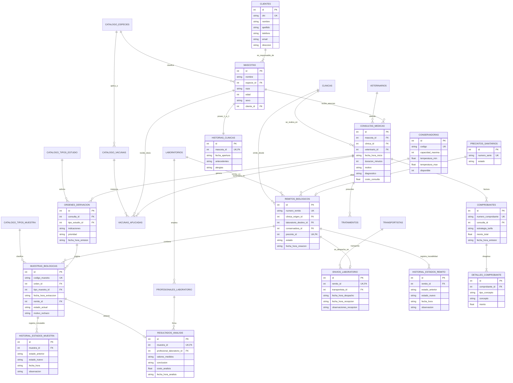

# Especificación Técnica de Base de Datos y Arquitectura de Software
## Proyecto Integrador: Red de Clínicas Veterinarias y Derivación de Laboratorio
**Cátedra:** Desarrollo de Aplicaciones con Objetos (DAO) — Ingeniería en Sistemas de Información (2026)  
**Tema:** Tema 2 — Veterinaria: Red de Clínicas y Derivación de Laboratorio  
**Motor de Persistencia:** SQLite 3.37+ con Tablas `STRICT` y Llaves Foráneas Activas (`PRAGMA foreign_keys = ON`)

---

## 1. Diagnóstico del Estado y Estructura del Proyecto

### 1.1. ¿Está completa la estructura del proyecto?
**Resumen ejecutivo:** La estructura arquitectónica de **Dominio**, **Patrones de Diseño**, **Persistencia (DAO / SQL)** y **Pruebas Automatizadas** está **100% desarrollada, robusta y con 52 tests pasando con éxito (0.26s)**. Sin embargo, el proyecto general **aún no está completo en su totalidad** para la entrega final: faltan por implementar la capa de **Servicios** (orquestación de casos de uso y los 4 reportes no triviales) y la capa de **Interfaz Gráfica** (`CustomTkinter`), además del archivo de arranque principal (`main.py`).

### 1.2. Árbol de Directorios y Estado de Implementación

```text
proyecto_veterinaria/
├── .gitignore
├── requirements.txt            # customtkinter>=5.2, pypdf (librerías externas)
├── veterinaria.db              # Base de datos SQLite física generada
├── docs/                       # Consignas de cátedra, guías DAO y teóricos
│   ├── TRABAJOPRACTICO.pdf     # Enunciado oficial del TP Integrador 2026
│   ├── DB Guia Objetos de Acceso.docx
│   └── especificacion_base_datos_y_arquitectura.md # Este documento técnico
├── src/
│   ├── __init__.py
│   ├── dominio/                # [COMPLETO] Entidades, dataclasses y validaciones de negocio
│   │   ├── cliente.py          # Entidad Cliente
│   │   ├── mascota.py          # Entidad Mascota (regla: responsable obligatorio)
│   │   ├── historia_clinica.py # Historia clínica, Tratamientos, Vacunas aplicadas
│   │   ├── consulta_medica.py  # Consulta médica y Órdenes de derivación
│   │   ├── muestra_biologica.py# Muestra biológica y transiciones de estado
│   │   ├── logistica.py        # Conservadoras, Precintos, Remitos y Envíos
│   │   ├── facturacion.py      # Comprobantes, Detalle y Resultados de laboratorio
│   │   └── excepciones.py      # Jerarquía de excepciones semánticas de negocio
│   ├── patrones/               # [COMPLETO] 4 Patrones GoF implementados
│   │   ├── estado_muestra.py   # Patrón STATE: Extraída -> Empaquetada -> EnTránsito -> Recibida -> Analizada / Rechazada
│   │   ├── estrategia_facturacion.py # Patrón STRATEGY: Tarifas (Plena, Obra Social, Urgencia)
│   │   ├── iterador_muestras.py# Patrón ITERATOR: Recorrido de muestras en conservadora
│   │   └── observador_eventos.py # Patrón OBSERVER: Notificaciones (muestra rechazada, resultados listos)
│   ├── persistencia/           # [COMPLETO] Capa DAO y motor relacional
│   │   ├── esquema.sql         # DDL de 26 tablas STRICT, constraints nombrados, índices y triggers
│   │   ├── conexion_bd.py      # SINGLETON: Gestión de conexión SQLite, transacciones atómicas
│   │   ├── inicializador_bd.py # DDL loader y precarga de catálogos paramétricos (idempotente)
│   │   ├── traductor_errores.py# Mapeador de SQLite Error/IntegrityError -> Excepciones de Dominio
│   │   ├── dao_base.py         # Clase abstracta base DAO
│   │   ├── cliente_dao.py      # CRUD y búsquedas de Cliente
│   │   ├── mascota_dao.py      # CRUD de Mascota e Historia Clínica
│   │   ├── consulta_dao.py     # Consultas médicas, tratamientos y órdenes
│   │   ├── logistica_dao.py    # Remitos, conservadoras, precintos y envíos
│   │   ├── muestra_dao.py      # Muestras biológicas y trazabilidad inmutable
│   │   └── facturacion_dao.py  # Resultados de laboratorio y Comprobantes cabecera-detalle
│   ├── servicios/              # [PENDIENTE] Solo contiene docstring en __init__.py
│   │   └── (Requiere: orquestación de casos de uso 1 a 7, validación horaria de agenda y reportes)
│   └── interfaz/               # [PENDIENTE] Solo contiene docstring en __init__.py
│       └── (Requiere: formularios y pantallas CustomTkinter conectadas a servicios)
└── tests/                      # [COMPLETO] Cobertura automatizada (52/52 tests pasados)
    ├── test_persistencia_base.py # Tests de conexión Singleton, constraints y triggers
    ├── test_dominio_y_patrones.py # Tests de State, Strategy, Iterator, Observer y entidades
    └── test_daos.py            # Tests de integración DAO contra SQLite en memoria
```

---

## 2. Diagrama de Base de Datos Relacional (Modelo Entidad-Relación)

A continuación se presenta el diagrama completo del modelo relacional en sintaxis Mermaid, agrupado por dominios funcionales.



---

## 3. Modelo Relacional en Notación Formal de Base de Datos

*Notación académica: `TABLA (PK, FK, Atributos)` con PK subrayada y FK en cursiva.*

1. **catalogo_especies** (<ins>id</ins>, nombre<sup>UK</sup>)
2. **catalogo_tipos_muestra** (<ins>id</ins>, codigo<sup>UK</sup>, nombre)
3. **catalogo_tipos_estudio** (<ins>id</ins>, codigo<sup>UK</sup>, nombre, costo_base)
4. **catalogo_vacunas** (<ins>id</ins>, nombre, *especie_id*<sup>FK</sup>, es_obligatoria, frecuencia_refuerzo_meses)  
   *Clave única alternativa: (nombre, especie_id)*
5. **clinicas** (<ins>id</ins>, nombre<sup>UK</sup>, direccion, telefono)
6. **veterinarios** (<ins>id</ins>, matricula<sup>UK</sup>, nombre, apellido, especialidad)
7. **laboratorios** (<ins>id</ins>, nombre<sup>UK</sup>, direccion, telefono)
8. **profesionales_laboratorio** (<ins>id</ins>, matricula<sup>UK</sup>, nombre, apellido, *laboratorio_id*<sup>FK</sup>)
9. **transportistas** (<ins>id</ins>, nombre, cuit_dni<sup>UK</sup>, vehiculo_patente, telefono)
10. **clientes** (<ins>id</ins>, dni<sup>UK</sup>, nombre, apellido, telefono, email, direccion)
11. **mascotas** (<ins>id</ins>, nombre, *especie_id*<sup>FK</sup>, raza, edad, sexo, *cliente_id*<sup>FK</sup>)
12. **historias_clinicas** (<ins>id</ins>, *mascota_id*<sup>UK, FK</sup>, fecha_apertura, antecedentes, alergias)
13. **consultas_medicas** (<ins>id</ins>, *mascota_id*<sup>FK</sup>, *clinica_id*<sup>FK</sup>, *veterinario_id*<sup>FK</sup>, fecha_hora_inicio, duracion_minutos, motivo, diagnostico, costo_consulta)  
    *Clave única alternativa: (veterinario_id, fecha_hora_inicio)*
14. **tratamientos** (<ins>id</ins>, *consulta_id*<sup>FK</sup>, descripcion, medicamento, dosis, duracion_dias)
15. **vacunas_aplicadas** (<ins>id</ins>, *mascota_id*<sup>FK</sup>, *vacuna_id*<sup>FK</sup>, *consulta_id*<sup>FK, opt</sup>, fecha_aplicacion)
16. **ordenes_derivacion** (<ins>id</ins>, *consulta_id*<sup>FK</sup>, *tipo_estudio_id*<sup>FK</sup>, indicaciones, prioridad, fecha_hora_emision)
17. **conservadoras** (<ins>id</ins>, codigo<sup>UK</sup>, capacidad_maxima, temperatura_min, temperatura_max, disponible)
18. **precintos_sanitarios** (<ins>id</ins>, numero_serie<sup>UK</sup>, estado)
19. **remitos_biologicos** (<ins>id</ins>, numero_remito<sup>UK</sup>, *clinica_origen_id*<sup>FK</sup>, *laboratorio_destino_id*<sup>FK</sup>, *conservadora_id*<sup>FK</sup>, *precinto_id*<sup>UK, FK, opt</sup>, estado, fecha_hora_creacion)
20. **historial_estados_remito** (<ins>id</ins>, *remito_id*<sup>FK</sup>, estado_anterior, estado_nuevo, fecha_hora, observacion)
21. **muestras_biologicas** (<ins>id</ins>, codigo_muestra<sup>UK</sup>, *orden_id*<sup>FK</sup>, *tipo_muestra_id*<sup>FK</sup>, fecha_hora_extraccion, *remito_id*<sup>FK, opt</sup>, estado_actual, motivo_rechazo)
22. **historial_estados_muestra** (<ins>id</ins>, *muestra_id*<sup>FK</sup>, estado_anterior, estado_nuevo, fecha_hora, observacion)
23. **envios_laboratorio** (<ins>id</ins>, *remito_id*<sup>UK, FK</sup>, *transportista_id*<sup>FK</sup>, fecha_hora_despacho, fecha_hora_recepcion, observaciones_recepcion)
24. **resultados_analisis** (<ins>id</ins>, *muestra_id*<sup>UK, FK</sup>, *profesional_laboratorio_id*<sup>FK</sup>, valores_medidos, conclusion, costo_analisis, fecha_hora_analisis)
25. **comprobantes** (<ins>id</ins>, numero_comprobante<sup>UK</sup>, *consulta_id*<sup>FK</sup>, estrategia_tarifa, monto_total, fecha_hora_emision)
26. **detalles_comprobante** (<ins>id</ins>, *comprobante_id*<sup>FK</sup>, tipo_concepto, concepto, monto)

---

## 4. Especificaciones Técnicas Detalladas (Diccionario de Datos)

El esquema implementa **tablas `STRICT`**, una característica introducida en SQLite 3.37 que obliga a respetar rigurosamente los tipos declarados (INTEGER, REAL, TEXT) y descarta el tipado dinámico tradicional de SQLite.

### 4.1. Catálogos Paramétricos

#### 1. `catalogo_especies`
Evita el texto libre ("Perro", "can", "Canino") y centraliza los tipos de animales admitidos.
| Columna | Tipo | Nulo | Restricciones / Descripción |
| :--- | :--- | :---: | :--- |
| `id` | INTEGER | NO | Clave Primaria Autoincremental. |
| `nombre` | TEXT | NO | `UNIQUE`. Nombre de la especie (ej. 'Canino', 'Felino'). |

#### 2. `catalogo_tipos_muestra`
Define los tipos biológicos válidos para extracción y conservación.
| Columna | Tipo | Nulo | Restricciones / Descripción |
| :--- | :--- | :---: | :--- |
| `id` | INTEGER | NO | Clave Primaria Autoincremental. |
| `codigo` | TEXT | NO | `UNIQUE`. Código alfanumérico (ej. 'SANGRE', 'ORINA', 'BIOPSIA'). |
| `nombre` | TEXT | NO | Descripción legible de la muestra. |

#### 3. `catalogo_tipos_estudio`
Estudios analíticos derivables al laboratorio central.
| Columna | Tipo | Nulo | Restricciones / Descripción |
| :--- | :--- | :---: | :--- |
| `id` | INTEGER | NO | Clave Primaria Autoincremental. |
| `codigo` | TEXT | NO | `UNIQUE`. Código identificador (ej. 'HEMOGRAMA'). |
| `nombre` | TEXT | NO | Denominación del estudio. |
| `costo_base` | REAL | NO | `CHECK (costo_base >= 0)`. Valor arancelario base. |

#### 4. `catalogo_vacunas`
Define el calendario sanitario y reglas de obligatoriedad según la especie animal.
| Columna | Tipo | Nulo | Restricciones / Descripción |
| :--- | :--- | :---: | :--- |
| `id` | INTEGER | NO | Clave Primaria Autoincremental. |
| `nombre` | TEXT | NO | Nombre de la vacuna (ej. 'Antirrábica'). |
| `especie_id` | INTEGER | NO | `REFERENCES catalogo_especies(id)`. |
| `es_obligatoria` | INTEGER | NO | `CHECK (es_obligatoria IN (0, 1))`. Booleano de obligatoriedad. |
| `frecuencia_refuerzo_meses`| INTEGER | SÍ | `CHECK (NULL OR > 0)`. Frecuencia de revacunación (NULL = dosis única). |
*Restricción de unicidad:* `UNIQUE (nombre, especie_id)` impide duplicar la misma vacuna para una misma especie.

---

### 4.2. Infraestructura y Personal de la Red

#### 5. `clinicas`
Clínicas periféricas donde se realiza la atención primaria y extracción de muestras.
| Columna | Tipo | Nulo | Restricciones / Descripción |
| :--- | :--- | :---: | :--- |
| `id` | INTEGER | NO | Clave Primaria Autoincremental. |
| `nombre` | TEXT | NO | `UNIQUE`. Nombre de la sede clínica. |
| `direccion` | TEXT | SÍ | Ubicación física. |
| `telefono` | TEXT | SÍ | Teléfono de contacto. |

#### 6. `veterinarios`
Profesionales veterinarios habilitados para consultas médicas y prescripciones.
| Columna | Tipo | Nulo | Restricciones / Descripción |
| :--- | :--- | :---: | :--- |
| `id` | INTEGER | NO | Clave Primaria Autoincremental. |
| `matricula` | TEXT | NO | `UNIQUE`. Matrícula profesional habilitante. |
| `nombre` | TEXT | NO | Nombre del profesional. |
| `apellido` | TEXT | NO | Apellido del profesional. |
| `especialidad` | TEXT | SÍ | Área de especialidad médica. |

#### 7. `laboratorios`
Laboratorio central de diagnóstico donde convergen las muestras biológicas.
| Columna | Tipo | Nulo | Restricciones / Descripción |
| :--- | :--- | :---: | :--- |
| `id` | INTEGER | NO | Clave Primaria Autoincremental. |
| `nombre` | TEXT | NO | `UNIQUE`. Nombre del laboratorio de análisis. |
| `direccion` | TEXT | SÍ | Dirección de la sede central. |
| `telefono` | TEXT | SÍ | Teléfono. |

#### 8. `profesionales_laboratorio`
Bioquímicos o patólogos responsables de analizar las muestras y emitir diagnósticos.
| Columna | Tipo | Nulo | Restricciones / Descripción |
| :--- | :--- | :---: | :--- |
| `id` | INTEGER | NO | Clave Primaria Autoincremental. |
| `matricula` | TEXT | NO | `UNIQUE`. Matrícula bioquímica. |
| `nombre` | TEXT | NO | Nombre. |
| `apellido` | TEXT | NO | Apellido. |
| `laboratorio_id` | INTEGER | NO | `REFERENCES laboratorios(id)`. Laboratorio al que pertenece. |

#### 9. `transportistas`
Empresas o choferes autorizados para el transporte bioseguro de muestras.
| Columna | Tipo | Nulo | Restricciones / Descripción |
| :--- | :--- | :---: | :--- |
| `id` | INTEGER | NO | Clave Primaria Autoincremental. |
| `nombre` | TEXT | NO | Razón social o nombre del transportista. |
| `cuit_dni` | TEXT | NO | `UNIQUE`. Identificador fiscal / documento. |
| `vehiculo_patente` | TEXT | SÍ | Patente del vehículo asignado. |
| `telefono` | TEXT | SÍ | Teléfono de guardia/seguimiento. |

---

### 4.3. Clientes, Mascotas e Historia Clínica (Procesos 1 y 2)

#### 10. `clientes`
Responsables legales y económicos de las mascotas atendidas.
| Columna | Tipo | Nulo | Restricciones / Descripción |
| :--- | :--- | :---: | :--- |
| `id` | INTEGER | NO | Clave Primaria Autoincremental. |
| `dni` | TEXT | NO | `UNIQUE`, `CHECK (dni NOT GLOB '*[^0-9]*' AND length(dni) BETWEEN 7 AND 8)`. |
| `nombre` | TEXT | NO | `CHECK (length(trim(nombre)) > 0)`. |
| `apellido` | TEXT | NO | `CHECK (length(trim(apellido)) > 0)`. |
| `telefono` | TEXT | NO | Teléfono de contacto. |
| `email` | TEXT | SÍ | `CHECK (email IS NULL OR email LIKE '%_@_%._%')`. Formato email válido. |
| `direccion` | TEXT | SÍ | Domicilio. |

#### 11. `mascotas`
Pacientes atendidos. Garantiza la regla: *"Toda mascota debe tener un responsable asociado"*.
| Columna | Tipo | Nulo | Restricciones / Descripción |
| :--- | :--- | :---: | :--- |
| `id` | INTEGER | NO | Clave Primaria Autoincremental. |
| `nombre` | TEXT | NO | `CHECK (length(trim(nombre)) > 0)`. |
| `especie_id` | INTEGER | NO | `REFERENCES catalogo_especies(id)`. |
| `raza` | TEXT | SÍ | Raza o mestizo. |
| `edad` | INTEGER | NO | `CHECK (edad >= 0)`. Edad cumplida en años. |
| `sexo` | TEXT | NO | `CHECK (sexo IN ('Macho', 'Hembra'))`. |
| `cliente_id` | INTEGER | NO | `REFERENCES clientes(id)`. Responsable obligatorio. |
*Índice:* `ix_mascotas_cliente ON mascotas(cliente_id)`.

#### 12. `historias_clinicas`
Cabecera médica unificada de la mascota en relación estricta 1 a 1.
| Columna | Tipo | Nulo | Restricciones / Descripción |
| :--- | :--- | :---: | :--- |
| `id` | INTEGER | NO | Clave Primaria Autoincremental. |
| `mascota_id` | INTEGER | NO | `UNIQUE`, `REFERENCES mascotas(id)`. Relación 1:1 estricta. |
| `fecha_apertura` | TEXT | NO | `CHECK (fecha_apertura IS date(fecha_apertura))`. Formato ISO `AAAA-MM-DD`. |
| `antecedentes` | TEXT | SÍ | Enfermedades preexistentes, cirugías previas. |
| `alergias` | TEXT | SÍ | Alergias medicamentosas o alimentarias. |

---

### 4.4. Atención Clínica, Prescripciones y Derivaciones (Proceso 3)

#### 13. `consultas_medicas`
Actos médicos realizados en las clínicas.
| Columna | Tipo | Nulo | Restricciones / Descripción |
| :--- | :--- | :---: | :--- |
| `id` | INTEGER | NO | Clave Primaria Autoincremental. |
| `mascota_id` | INTEGER | NO | `REFERENCES mascotas(id)`. |
| `clinica_id` | INTEGER | NO | `REFERENCES clinicas(id)`. Clínica donde se atiende. |
| `veterinario_id` | INTEGER | NO | `REFERENCES veterinarios(id)`. |
| `fecha_hora_inicio` | TEXT | NO | `CHECK (fecha_hora_inicio IS strftime('%Y-%m-%d %H:%M:%S', fecha_hora_inicio))`. |
| `duracion_minutos` | INTEGER | NO | `DEFAULT 30`, `CHECK (duracion_minutos > 0)`. |
| `motivo` | TEXT | NO | Motivo de la consulta / síntomas. |
| `diagnostico` | TEXT | SÍ | Diagnóstico presuntivo o de certeza. |
| `costo_consulta` | REAL | NO | `DEFAULT 0.0`, `CHECK (costo_consulta >= 0)`. |
*Restricción de unicidad:* `UNIQUE (veterinario_id, fecha_hora_inicio)` evita dos turnos simultáneos exactos.  
*Índices:* `ix_consultas_mascota`, `ix_consultas_clinica`.

#### 14. `tratamientos`
Indicaciones terapéuticas y farmacológicas recetadas durante la consulta.
| Columna | Tipo | Nulo | Restricciones / Descripción |
| :--- | :--- | :---: | :--- |
| `id` | INTEGER | NO | Clave Primaria Autoincremental. |
| `consulta_id` | INTEGER | NO | `REFERENCES consultas_medicas(id)`. |
| `descripcion` | TEXT | NO | Indicaciones terapéuticas. |
| `medicamento` | TEXT | SÍ | Fármaco indicado. |
| `dosis` | TEXT | SÍ | Posología (ej. '1 comprimido cada 12 hs'). |
| `duracion_dias` | INTEGER | SÍ | `CHECK (duracion_dias IS NULL OR duracion_dias > 0)`. |
*Índice:* `ix_tratamientos_consulta`.

#### 15. `vacunas_aplicadas`
Registro de inmunizaciones. Alimenta el reporte de *"Tratamientos aplicados y vacunas pendientes"*.
| Columna | Tipo | Nulo | Restricciones / Descripción |
| :--- | :--- | :---: | :--- |
| `id` | INTEGER | NO | Clave Primaria Autoincremental. |
| `mascota_id` | INTEGER | NO | `REFERENCES mascotas(id)`. |
| `vacuna_id` | INTEGER | NO | `REFERENCES catalogo_vacunas(id)`. |
| `consulta_id` | INTEGER | SÍ | `REFERENCES consultas_medicas(id)`. NULL si es antecedente externo. |
| `fecha_aplicacion` | TEXT | NO | `CHECK (fecha_aplicacion IS date(fecha_aplicacion))`. |
*Índice:* `ix_vacunas_aplicadas_mascota`.

#### 16. `ordenes_derivacion`
Prescripción de análisis hacia el laboratorio central cuando el caso clínico lo requiere.
| Columna | Tipo | Nulo | Restricciones / Descripción |
| :--- | :--- | :---: | :--- |
| `id` | INTEGER | NO | Clave Primaria Autoincremental. |
| `consulta_id` | INTEGER | NO | `REFERENCES consultas_medicas(id)`. |
| `tipo_estudio_id` | INTEGER | NO | `REFERENCES catalogo_tipos_estudio(id)`. |
| `indicaciones` | TEXT | SÍ | Instrucciones especiales o sospecha clínica. |
| `prioridad` | TEXT | NO | `DEFAULT 'Normal'`, `CHECK (prioridad IN ('Normal', 'Urgente'))`. |
| `fecha_hora_emision` | TEXT | NO | Formato ISO 8601 completo. |
*Índice:* `ix_ordenes_consulta`.

---

### 4.5. Logística Sanitaria: Conservadoras, Precintos y Remitos (Procesos 4, 5 y 6)

#### 17. `conservadoras`
Contenedores isotérmicos para transporte bioseguro de muestras.
| Columna | Tipo | Nulo | Restricciones / Descripción |
| :--- | :--- | :---: | :--- |
| `id` | INTEGER | NO | Clave Primaria Autoincremental. |
| `codigo` | TEXT | NO | `UNIQUE`. Identificador físico (ej. 'CONS-001'). |
| `capacidad_maxima` | INTEGER | NO | `CHECK (capacidad_maxima > 0)`. Cantidad máxima de tubos/frascos. |
| `temperatura_min` | REAL | SÍ | Límite térmico inferior en °C. |
| `temperatura_max` | REAL | SÍ | `CHECK (min IS NULL OR max IS NULL OR min <= max)`. |
| `disponible` | INTEGER | NO | `DEFAULT 1`, `CHECK (disponible IN (0, 1))`. |

#### 18. `precintos_sanitarios`
Elemento de seguridad física que garantiza la inviolabilidad de la cadena de frío y custodia.
| Columna | Tipo | Nulo | Restricciones / Descripción |
| :--- | :--- | :---: | :--- |
| `id` | INTEGER | NO | Clave Primaria Autoincremental. |
| `numero_serie` | TEXT | NO | `UNIQUE`. Código de seguridad único e irrepetible. |
| `estado` | TEXT | NO | `DEFAULT 'Intacto'`, `CHECK (estado IN ('Intacto', 'Roto', 'Violado'))`. |

#### 19. `remitos_biologicos`
Documento de derivación que consolida el lote de muestras enviado por una clínica.
| Columna | Tipo | Nulo | Restricciones / Descripción |
| :--- | :--- | :---: | :--- |
| `id` | INTEGER | NO | Clave Primaria Autoincremental. |
| `numero_remito` | TEXT | NO | `UNIQUE`. Identificador comercial/sanitario. |
| `clinica_origen_id` | INTEGER | NO | `REFERENCES clinicas(id)`. |
| `laboratorio_destino_id` | INTEGER | NO | `REFERENCES laboratorios(id)`. |
| `conservadora_id` | INTEGER | NO | `REFERENCES conservadoras(id)`. |
| `precinto_id` | INTEGER | SÍ | `UNIQUE`, `REFERENCES precintos_sanitarios(id)`. Asignado al precintar. |
| `estado` | TEXT | NO | `DEFAULT 'EnPreparacion'`, `CHECK (estado IN ('EnPreparacion', 'Precintado', 'EnTransito', 'Recibido', 'Rechazado'))`. |
| `fecha_hora_creacion` | TEXT | NO | ISO 8601 con strftime. |
*Restricción de negocio:* `CHECK (estado = 'EnPreparacion' OR precinto_id IS NOT NULL)` asegura que ningún remito viaje sin precinto.  
*Índice:* `ix_remitos_estado`.

#### 20. `historial_estados_remito`
Trazabilidad auditable inmutable de las transiciones del remito biológico.
| Columna | Tipo | Nulo | Restricciones / Descripción |
| :--- | :--- | :---: | :--- |
| `id` | INTEGER | NO | Clave Primaria Autoincremental. |
| `remito_id` | INTEGER | NO | `REFERENCES remitos_biologicos(id)`. |
| `estado_anterior` | TEXT | SÍ | NULL en la creación inicial. |
| `estado_nuevo` | TEXT | NO | Estado alcanzado. |
| `fecha_hora` | TEXT | NO | Momento exacto de la transición. |
| `observacion` | TEXT | SÍ | Justificación / detalle del evento. |
*Índice:* `ix_historial_remito`.  
*Seguridad:* **Protegido por triggers SQL contra UPDATE y DELETE.**

#### 21. `envios_laboratorio`
Registra el despacho físico y la recepción en el laboratorio con el transportista.
| Columna | Tipo | Nulo | Restricciones / Descripción |
| :--- | :--- | :---: | :--- |
| `id` | INTEGER | NO | Clave Primaria Autoincremental. |
| `remito_id` | INTEGER | NO | `UNIQUE`, `REFERENCES remitos_biologicos(id)`. Relación 1:1. |
| `transportista_id` | INTEGER | NO | `REFERENCES transportistas(id)`. |
| `fecha_hora_despacho` | TEXT | NO | Momento de salida de la clínica. |
| `fecha_hora_recepcion`| TEXT | SÍ | Momento de entrega en laboratorio (NULL en viaje). |
| `observaciones_recepcion` | TEXT | SÍ | Novedades del arribo. |
*Restricción:* `CHECK (fecha_hora_recepcion IS NULL OR fecha_hora_recepcion >= fecha_hora_despacho)`.

---

### 4.6. Muestras Biológicas y Trazabilidad (Núcleo del Sistema)

#### 22. `muestras_biologicas`
Entidad medular del sistema y modelo del patrón GoF State.
| Columna | Tipo | Nulo | Restricciones / Descripción |
| :--- | :--- | :---: | :--- |
| `id` | INTEGER | NO | Clave Primaria Autoincremental. |
| `codigo_muestra` | TEXT | NO | `UNIQUE`. Identificador unívoco (ej. 'MUE-2026-0001'). |
| `orden_id` | INTEGER | NO | `REFERENCES ordenes_derivacion(id)`. |
| `tipo_muestra_id` | INTEGER | NO | `REFERENCES catalogo_tipos_muestra(id)`. |
| `fecha_hora_extraccion` | TEXT | NO | Fecha y hora de extracción física. |
| `remito_id` | INTEGER | SÍ | `REFERENCES remitos_biologicos(id)`. NULL si aún no fue empaquetada. |
| `estado_actual` | TEXT | NO | `DEFAULT 'Extraida'`, `CHECK (estado_actual IN ('Extraida', 'Empaquetada', 'EnTransito', 'Recibida', 'Analizada', 'Rechazada'))`. |
| `motivo_rechazo` | TEXT | SÍ | `CHECK (estado_actual <> 'Rechazada' OR motivo_rechazo IS NOT NULL)`. Obligatorio si se rechaza. |
*Restricción:* `CHECK (estado_actual = 'Extraida' OR remito_id IS NOT NULL)` garantiza que una muestra no avance sin remito.  
*Índices:* `ix_muestras_orden`, `ix_muestras_remito`, `ix_muestras_estado`.

#### 23. `historial_estados_muestra`
Log inmutable exigido por la consigna: *"Mantener la trazabilidad inmutable de estados de la muestra"*.
| Columna | Tipo | Nulo | Restricciones / Descripción |
| :--- | :--- | :---: | :--- |
| `id` | INTEGER | NO | Clave Primaria Autoincremental. |
| `muestra_id` | INTEGER | NO | `REFERENCES muestras_biologicas(id)`. |
| `estado_anterior` | TEXT | SÍ | NULL en la extracción inicial. |
| `estado_nuevo` | TEXT | NO | Estado adquirido. |
| `fecha_hora` | TEXT | NO | Timestamp de la mutación de estado. |
| `observacion` | TEXT | SÍ | Causa del cambio de estado. |
*Índice:* `ix_historial_muestra`.  
*Seguridad:* **Protegido por triggers SQL contra UPDATE y DELETE.**

---

### 4.7. Resultados y Facturación (Proceso 7)

#### 24. `resultados_analisis`
Diagnóstico laboratorial y valores medidos emitidos por el bioquímico.
| Columna | Tipo | Nulo | Restricciones / Descripción |
| :--- | :--- | :---: | :--- |
| `id` | INTEGER | NO | Clave Primaria Autoincremental. |
| `muestra_id` | INTEGER | NO | `UNIQUE`, `REFERENCES muestras_biologicas(id)`. 1 resultado por muestra. |
| `profesional_laboratorio_id` | INTEGER | NO | `REFERENCES profesionales_laboratorio(id)`. Firma profesional. |
| `valores_medidos` | TEXT | NO | Parámetros cuantificados (ej. glóbulos rojos, glucosa). |
| `conclusion` | TEXT | NO | Informe diagnóstico del laboratorio. |
| `costo_analisis` | REAL | NO | `CHECK (costo_analisis >= 0)`. Valor económico del análisis. |
| `fecha_hora_analisis` | TEXT | NO | Fecha y hora de finalización del estudio. |

#### 25. `comprobantes`
Cabecera de facturación vinculada a la consulta clínica y calculada mediante el patrón Strategy.
| Columna | Tipo | Nulo | Restricciones / Descripción |
| :--- | :--- | :---: | :--- |
| `id` | INTEGER | NO | Clave Primaria Autoincremental. |
| `numero_comprobante` | TEXT | NO | `UNIQUE`. Identificador fiscal/comprobante (ej. 'FAC-0001-00000001'). |
| `consulta_id` | INTEGER | NO | `REFERENCES consultas_medicas(id)`. |
| `estrategia_tarifa` | TEXT | NO | Nombre de la estrategia GoF Strategy aplicada (ej. 'TarifaPlena', 'TarifaObraSocial'). |
| `monto_total` | REAL | NO | `CHECK (monto_total >= 0)`. Suma algebraica de los detalles. |
| `fecha_hora_emision` | TEXT | NO | Momento de facturación. |
*Índice:* `ix_comprobantes_consulta`.

#### 26. `detalles_comprobante`
Renglones o conceptos desglosados del comprobante.
| Columna | Tipo | Nulo | Restricciones / Descripción |
| :--- | :--- | :---: | :--- |
| `id` | INTEGER | NO | Clave Primaria Autoincremental. |
| `comprobante_id` | INTEGER | NO | `REFERENCES comprobantes(id)`. |
| `tipo_concepto` | TEXT | NO | `CHECK (tipo_concepto IN ('Consulta', 'Laboratorio', 'Vacuna', 'Tratamiento', 'Recargo', 'Bonificacion'))`. |
| `concepto` | TEXT | NO | Descripción del ítem facturado. |
| `monto` | REAL | NO | Importe monetario. |
*Restricción de signo contable:* `CHECK ((tipo_concepto = 'Bonificacion' AND monto <= 0) OR (tipo_concepto <> 'Bonificacion' AND monto >= 0))`.

---

## 5. Triggers de Base de Datos e Inmutabilidad

Para cumplir con la consigna obligatoria: **"Mantener la trazabilidad inmutable de estados de la muestra"**, se implementan 4 triggers a nivel de motor SQLite que abortan cualquier intento de alteración física o eliminación sobre las tablas de auditoría:

```sql
-- 1. Rechazar modificaciones sobre el historial de muestras
CREATE TRIGGER trg_historial_muestra_sin_modificar
BEFORE UPDATE ON historial_estados_muestra
BEGIN
    SELECT RAISE(ABORT, 'El historial de estados de la muestra es inmutable: no puede modificarse.');
END;

-- 2. Rechazar eliminaciones sobre el historial de muestras
CREATE TRIGGER trg_historial_muestra_sin_eliminar
BEFORE DELETE ON historial_estados_muestra
BEGIN
    SELECT RAISE(ABORT, 'El historial de estados de la muestra es inmutable: no puede eliminarse.');
END;

-- 3. Rechazar modificaciones sobre el historial de remitos
CREATE TRIGGER trg_historial_remito_sin_modificar
BEFORE UPDATE ON historial_estados_remito
BEGIN
    SELECT RAISE(ABORT, 'El historial de estados del remito es inmutable: no puede modificarse.');
END;

-- 4. Rechazar eliminaciones sobre el historial de remitos
CREATE TRIGGER trg_historial_remito_sin_eliminar
BEFORE DELETE ON historial_estados_remito
BEGIN
    SELECT RAISE(ABORT, 'El historial de estados del remito es inmutable: no puede eliminarse.');
END;
```

---

## 6. Matriz de Cumplimiento: Requisitos del TP vs. Diseño del Esquema

| Requisito / Validación del TP | Implementación en Base de Datos / DAO | Justificación de Diseño |
| :--- | :--- | :--- |
| **1. Toda mascota debe tener un responsable asociado.** | `mascotas.cliente_id INTEGER NOT NULL REFERENCES clientes(id)` + validación en `Mascota.validar()`. | Integridad referencial mandatoria. Ningún registro huérfano puede crearse. |
| **2. Trazabilidad inmutable de estados de la muestra.** | Tablas `historial_estados_muestra` y `historial_estados_remito` + Triggers `RAISE(ABORT)` en `BEFORE UPDATE` y `BEFORE DELETE`. | Cumple con requerimientos forenses y de auditoría médica. |
| **3. Rechazo si el precinto sanitario llega roto/violado.** | `precintos_sanitarios.estado IN ('Intacto', 'Roto', 'Violado')` + `muestras_biologicas.estado_actual = 'Rechazada'` + `motivo_rechazo NOT NULL`. | La recepción en laboratorio verifica el precinto y bifurca la muestra a estado 'Rechazada' sin permitir su análisis. |
| **4. Evitar turnos médicos duplicados.** | `UNIQUE (veterinario_id, fecha_hora_inicio)` en `consultas_medicas`. | Red de seguridad en motor; la validación por rango de solapamiento `[inicio, inicio+duración)` se coordina en servicios. |
| **5. Esquema de vacunas obligatorias.** | `catalogo_vacunas (es_obligatoria, frecuencia_refuerzo_meses)` cruzado con `vacunas_aplicadas (mascota_id, fecha_aplicacion)`. | Permite calcular vacunas vencidas o pendientes según especie y edad. |
| **6. Desglose de facturación.** | `comprobantes` (cabecera con `estrategia_tarifa`) y `detalles_comprobante` (conceptos tipificados con signo validado). | Soporta el patrón GoF Strategy y habilita el reporte de facturación por clínica y laboratorio. |
| **7. Eficiencia en reportes no triviales.** | Índices explícitos sobre todas las llaves foráneas (`cliente_id`, `mascota_id`, `orden_id`, `remito_id`, `estado_actual`). | Maximiza la velocidad en JOINs y agregaciones (`GROUP BY`, `COUNT`, `AVG`). |

---

## 7. Plan de Acción para Completar el Proyecto

Para dejar el proyecto listo para la presentación con el profesor:

1. **Capa de Servicios (`src/servicios/`):**
   - Implementar los flujos de los procesos 1 al 7 coordinando los DAOs en transacciones atómicas.
   - Implementar la validación de superposición horaria para veterinarios (`fecha_hora_inicio` + `duracion_minutos`).
   - Implementar los 4 reportes obligatorios:
     1. Atenciones clínicas y derivaciones realizadas por período y clínica.
     2. Muestras rechazadas clasificadas por causas logísticas / precinto.
     3. Tratamientos aplicados y vacunas pendientes por mascota.
     4. Facturación desglosada por clínica, laboratorio y tipo de concepto.
2. **Capa de Interfaz Gráfica (`src/interfaz/`):**
   - Diseñar las vistas con `CustomTkinter` consumiendo exclusivamente la capa de servicios.
3. **Punto de Entrada (`main.py`):**
   - Inicializar la base de datos de manera transparente y levantar la ventana principal.
